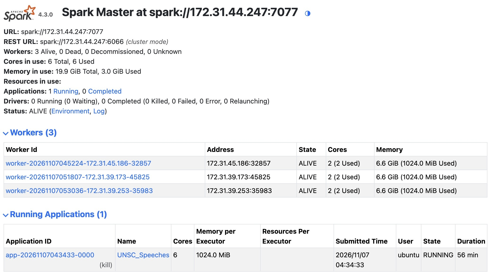
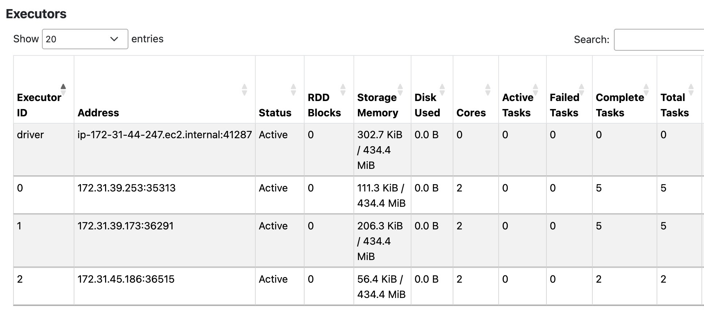

# DSAN 6000 Homework 7: A Single Spark Cluster Can Start a Prairie Fire

**Due Sunday, November 15, 11:59pm EDT**

> \[!WARNING\] If you have cloned the repository **template** from the
> `https://github.com/jpowerj/dsan6000-hw07` URL, you are **not starting
> the assignment correctly!** That is, if the command you used to clone
> the repo onto EC2 looks like:
>
> `git clone https://github.com/jpowerj/dsan6000-hw07`
>
> This will **not work** for assignments in this course, since you
> **will not be able to push your changes** back to this repository!
> (Notice how the above code purposefully has *no copy button!*)
> Instead, you need to create your **own *private* version of the
> template** (shared with instructors only), as described in the next
> section.

### Creating Your Own *Private* Repo From the Template

Click the **green “Use this template” button** in the upper-right corner
of the template repo on GitHub, then choose the “Create a new
repository” option. On the next page, you will be able to create a **new
repository** in **your own GitHub account**. Follow these steps to set
up your new private repository:

1.  Within the **“1. General”** section, call it **`dsan6000-hw06`**
    (the same name as the template), and
2.  Within the **“2. Configuration”** section, choose **Private**
3.  Click the green **Create Repository** button
4.  Once the repository has been created, open the **Settings** page
    linked at the top of the GitHub interface
5.  In the menu on the left side of the Settings page, within the
    **“Access”** section, click **“Collaborators”**
6.  Use the **“Manage access”** portion of this Collaborators page to
    add the course instructors via our GitHub usernames, given in the
    following table:

<table>

<thead>

</thead>

<tbody>

<tr>

<td>

Jeff
</td>

<td>

    jpowerj

</td>

</tr>

<tr>

<td>

Samyu
</td>

<td>

    samyu-vakkalanka

</td>

</tr>

<tr>

<td>

Fangzhou
</td>

<td>

    fangzhou-wang

</td>

</tr>

<tr>

<td>

Siru
</td>

<td>

    siruwuu

</td>

</tr>

</tbody>

</table>

Once this **derived** private repository has been set up on **your
GitHub account**, and you have added the instructors as collaborators,
you are all set up to **submit the URL for your newly-created repository
on Canvas!** Please submit the URL immediately after creating the repo:
this is what will allow us to see your progress and check any issues
between distribution and submission.

Then, once you have submitted the URL on Canvas, **clone *your*
newly-created repository (*not* the template owned by `jpowerj`) to your
EC2 instance to begin working!** In other words, the command you run on
EC2 should look as follows (with your GitHub username in place of
`YOUR_GH_USERNAME`):

``` bash
git clone https://github.com/YOUR_GH_USERNAME/dsan6000-hw07
```

Note that this and other `git` commands interacting with your GitHub
repository will likely require you to use a GitHub **Access Token** in
place of your password (despite the fact that `git` will ask you for
your password, the password you use to log into your GitHub account in
your browser typically will *not* work within the `git` command-line
interface).

To create this Access Token, **follow the instructions
[here](https://docs.github.com/en/authentication/keeping-your-account-and-data-secure/managing-your-personal-access-tokens#creating-a-personal-access-token-classic)**:
you can just check off all permissions (since this is a case of you
“granting” permissions to yourself – you would need to worry about
specific permissions if you were granting access to a coworker on a
project, for example!), and you don’t need to choose an expiration date
for this Access Token (though you can for extra account security).

## HW7 Task: Counting Number of Speeches By Country

Jeff is, it turns out, genuinely incapable of finding large datasets
that are not related to political economy, so, for this homework the
simplest possible Spark-relevant task I could come up with is as
follows:

- First, using the [checklist
  slide](https://jjacobs.me/dsan6000/w08/slides.html#/in-class-demo-2-your-first-spark-cluster)
  from Week 8, you will create your first **Spark cluster**, with **two
  worker nodes** attached to your **“main” EC2 instance** (the instance
  you’ve been using all semester)
- Then, to see it in action, you will use this cluster to **scan over**
  [**80 years of UN Security Council
  meetings**](https://academic.oup.com/jpr/article/63/4/735/8559606)
  (Sakamoto et al. 2026) to count **which countries talk the most** when
  the Security Council is in session.

The core of the assignment (I promise) is to just get a Spark cluster –
with **two EC2 instances attached as worker nodes** – up and running
within your AWS account! Thus, the actual PySpark code that carries out
these country-by-country counts is **provided for you:** as long as your
Spark cluster is up and running as expected, you have done your part for
the assignment, and the “proof” that you’ll submit will just be:

* The completed `DSAN6000_HW08.ipynb` file (meaning just, the provided notebook within this repo, where the provided code cells should be run and their outputs should be retained)
* An `affiliation_counts.csv` file, which the final code cell in the `.ipynb` notebook saves, and
* **Two screenshots**:
  * One called `master-ui.jpeg` (or png) showing the **Master node UI** with three worker nodes connected to it, and
  * One called `session-ui.jpeg` (or png) showing the **Executors tab within the `SparkSession` UI**, demonstrating again that the **`SparkSession`** (and not just the master node) has three workers connected to it, with 2 cores each.

Examples of these two screenshots are provided below, for comparison with your own (some details like the IP addresses should be different, but things like the **number of cores** and the **number of attached worker nodes** should be the same!)

<center>

<br><i>Example `master-ui.jpeg` screenshot</i>

</center>

<center>

<br><i>Example `session-ui.jpeg` screenshot</i>

</center>

## References

<div id="refs" class="references csl-bib-body hanging-indent">

<div id="ref-sakamoto_security_2026" class="csl-entry">

Sakamoto, Takuto, Tomoyuki Matsuoka, and Hiroto Ito. 2026. “The Security
Council in Its Entirety: Unveiling 80 Years of Deliberation Through the
UNSC Meetings and Speeches Dataset.” *Journal of Peace Research* 63 (4):
735–44. <https://doi.org/10.1093/jopres/xjag018>.

</div>

</div>

------------------------------------------------------------------------

Assignment hash (SHA-256):
`40b1493bc09879143e5955efead4aa7908b85dc43bac90acf90c4f1e597c5aa6`
